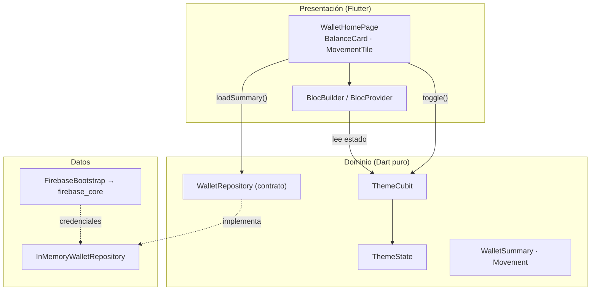
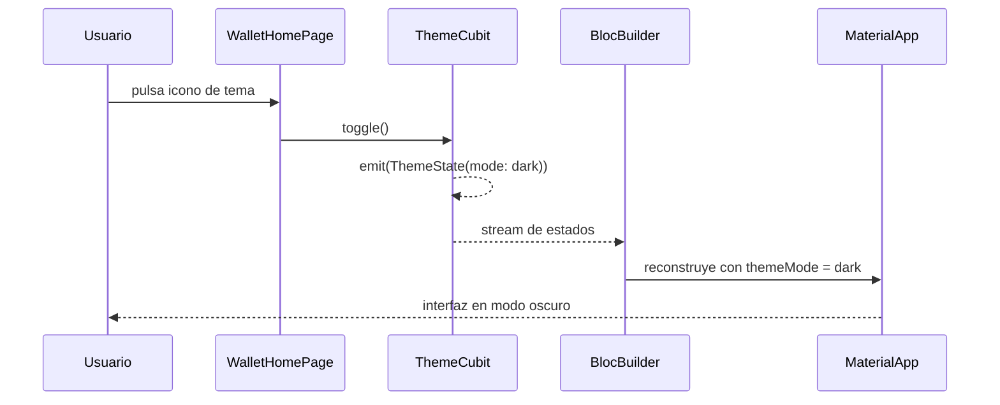

# Arquitectura de Wallet UNSAAC — Sesión 1

## Diagrama de capas



## Regla de dependencia

```text
presentation  →  domain  ←  data
```

- `presentation` importa entidades, contratos de repositorio y estados.
- `data` implementa los contratos y depende de infraestructura (memoria,
  Firebase, HTTP).
- `domain` no importa `flutter/material.dart`, `firebase_core` ni `http`.

## Flujo del tema



## Estructura por funcionalidad

```text
features/
└── wallet/
    ├── domain/        # entidades y contratos
    ├── data/          # implementaciones (memoria, Firestore)
    └── presentation/  # páginas y widgets
```

Cuando la unidad avance, se agregarán `features/auth/` y
`features/transactions/` con la misma forma. La estructura no cambia: cambia el
contenido de cada capa.
